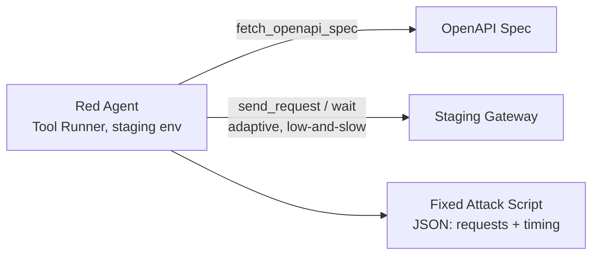
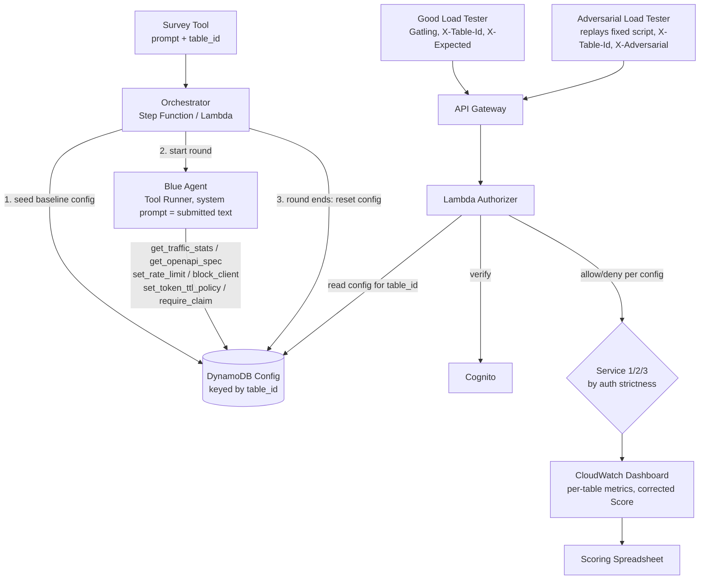

# From Fuzzing to Artificial Intelligence: How API Gateway Defenses Must Evolve

**Topic 2** · Content Area: Software Security · Experience level: Mid · Audience Career Track: Operational/Architectural · Presentation Type: Tabletops and Gamified Exercises

## Full Description

Traditional API defenses (rate limiting, OAuth, WAF rules) were built to stop noisy attackers but artificial intelligence has changed the game. In this hands-on exercise, teams face an artificial intelligence-driven attacker that probes APIs with surgical precision: staying under throttling thresholds, exploiting Open API Specification documentation, and generating targeted payloads that legacy fuzzing detection completely misses. Red teams attempt low-and-slow reconnaissance while blue teams deploy anomaly detection, behavioral token analysis, and integrated OAuth controls to respond. Debrief reveals exactly where traditional gateway controls fail and what platform and security teams must implement together to close the gap before attackers do.

The attacker itself is not a script — an AI agent reads the target's OpenAPI specification and crafts an adaptive, spec-aware, low-and-slow request sequence, recorded once and replayed identically for every table so every team faces the exact same precision attack.

## Key Differentiator

Most API security sessions lecture about threats. This exercise puts attendees inside one. The artificial intelligence-versus-human attack simulation exposes a critical blind spot: defenses calibrated to identify fuzzing or scans allow artificial intelligence-driven precision probing to sneak through — a gap most platform and security teams haven't operationalized a response to yet.

## Takeaways

- Differentiate between traditional fuzzing/scanning attacks versus AI-driven precision probing, and explain why legacy API Gateway defenses fail to detect the latter.
- Demonstrate anomaly detection and behavioral token analysis techniques that identify "low-and-slow" AI reconnaissance before a breach occurs.
- Construct a layered API Gateway defense strategy combining OAuth controls, rate limiting, and AI-based anomaly detection to close the gap between noisy and precision attacks.

---

## Presentation

**Title:** From Fuzzing to Artificial Intelligence: How API Gateway Defenses Must Evolve
**Audience:** 72 people, 6 per table, 12 tables.

**Schedule (1 hour)**
- 15 min — Intro & Plan
- 30 min — Activity (5 min per 2x tables, 6 doubles run sequentially)
- 15 min — Summary & QA

**High Level Activity**
Each table drives a Claude-powered defensive agent by submitting one free-text prompt (via a survey tool, tagged with their table number) that becomes the agent's operating instructions for that round. The agent has access to a fixed, published set of defensive tools — it decides for itself how to use them against live traffic for the round. The system is reset to baseline between teams.

Any reduction in original (legitimate) traffic costs points; any reduction in breached attack attempts gains points. A spreadsheet tracks points per table. Winning table gets a prize.

**Scoring**

```
Score = (N_malicious_baseline − N_malicious_attempt) − (N_good_baseline − N_good_attempt)
```

- Blocking more malicious traffic than baseline → positive contribution (GOOD).
- Blocking any legitimate traffic below baseline → penalty (BAD).
- `N_good_baseline` and `N_malicious_baseline` are held constant across all 12 tables by construction (see Architecture below), so every table's score is directly comparable.

---

## Architecture

All AWS-native, deployed via CloudFormation for quick setup/teardown.

**Good Client Load Tester** — Gatling with OAuth machine-to-machine tokens (1-minute token expiry). Header: `X-Expected: true`, plus `X-Table-Id` for per-round isolation.

**Adversarial Load Tester** — replays a *fixed, pre-recorded* attack script generated once, ahead of the event, by an AI agent (Claude, Tool Runner pattern) that reads the OpenAPI spec and crafts an adaptive, spec-aware, low-and-slow request sequence against a staging copy of the gateway. Replaying the identical script at every table keeps the "AI-driven precision attacker" claim accurate while holding `N_malicious_baseline` constant for fair scoring. Header: `X-Adversarial: true`, plus `X-Table-Id`.

**AI Defensive Tool** — a Claude API Tool Runner agent, one shared harness and one fixed published tool manifest for every table. The table's submitted prompt becomes that round's system prompt; the agent autonomously decides which tools to call. Published tools:
- `get_traffic_stats(window_seconds)`
- `get_openapi_spec()`
- `set_rate_limit(match_criteria, requests_per_second)`
- `block_client(match_criteria)` / `unblock_client(match_criteria)`
- `set_token_ttl_policy(seconds)`
- `require_additional_claim(claim_name, expected_value)`
- `get_current_config()`

Tool calls write to a DynamoDB config table keyed by `table_id`; a Lambda authorizer reads that row on every request. This makes "hot deployment" a data read (sub-second), not a stack redeploy — critical given each table's round is only 5 minutes, and two tables run concurrently per slot on one shared stack, isolated by `table_id`.

**Gateway** — AWS API Gateway with a custom authorizer Lambda that consults Cognito and the per-table DynamoDB config, then routes to one of three backend microservices.

**Service 1 / 2 / 3** — AWS API Gateway + authorizer, each returning `{"approved": "true"}` on success, with limited / moderate / extreme secondary auth respectively.

**CloudWatch Dashboard** — last 5 minutes of traffic, dimensioned by `table_id`; computes the corrected Score above per table in near-real time.

### Flow

**Offline, once — generating the fixed adversarial script:**



**Live, per table — repeats 12x, 2 concurrent per 5-min slot:**



---

## Open items for build phase (post-acceptance)

1. Generate and lock the adversarial attack script well before event day — it has real lead time.
2. Benchmark Claude Opus 5 vs. Sonnet 5 for the blue agent's per-round latency/cost and pick before finalizing the orchestrator.
3. Validate native AWS WAF rate-based rule evaluation windows if WAF is used anywhere outside the DynamoDB-backed authorizer path (its native windows are too slow for a 5-minute round on their own).
